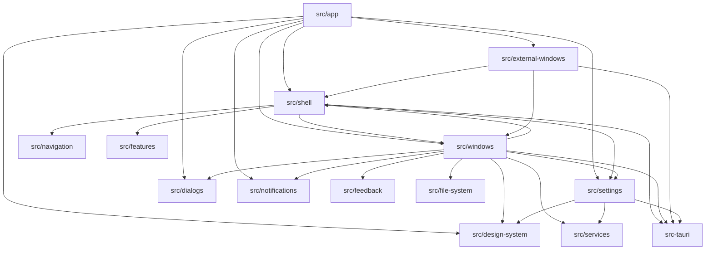

# Ember Studio Foundation

Reusable Windows desktop application foundation built with React, TypeScript, Vite, and Tauri.

 

[](docs/screenshots/ember-studio-color-profiles.jpg)

## Features

- Borderless custom title bar with native window controls
- Collapsible navigation and project-owned design tokens
- Internal window manager with move, resize, minimize, maximize, and z-order behavior
- Optional external Tauri feature windows
- Generic file, settings, notification, dialog, tooltip, and feedback service boundaries
- Placeholder Data Explorer and foundation welcome experience
- Typed service contracts for future Java, Python, Rust, C#, or local HTTP/WebSocket services

## Architecture



React + TypeScript + Vite owns the presentation and interaction layers in `src`. Tauri v2/Rust owns OS boundaries and persistence in `src-tauri`. Shared shell behavior is organized into focused modules, while business-specific code remains under `src/features/`. See [backend integration guidance](docs/architecture/backend-boundary.md) and the [foundation guide](docs/foundation-guide.md) for more details.

## Quick start

Requires Node.js 20.19 or newer, npm, and Tauri v2 prerequisites.

```bash
npm install
npm run dev
npm test
npm run build
```

## Configuration

| File | Purpose | Default |
|------|---------|---------|
| `src-tauri/tauri.conf.json` | Tauri configuration | Included |

## Screenshots

[](docs/screenshots/ember-studio-collapsed-navigation.jpg)

## Roadmap

See issues.

## License & credits

MIT License. See [LICENSE](./LICENSE).
